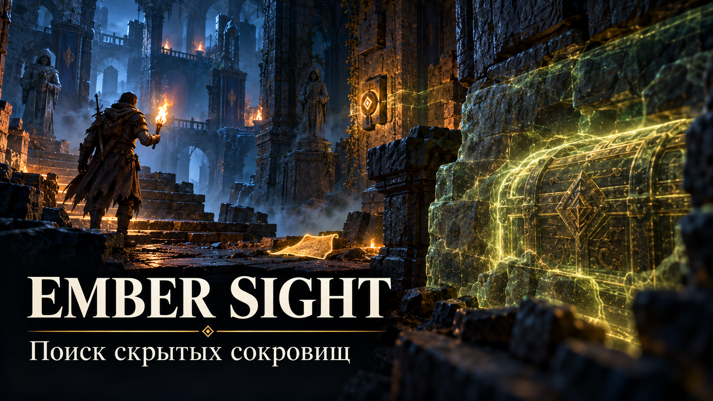

[Скачать мод — Ember-Sight-release.zip](https://github.com/Daber-devNull/ember-sight/raw/refs/heads/main/Ember-Sight-release.zip)

# Ember Sight — поиск скрытых сокровищ

**Автор: Daber (hypeber)**

Ember Sight помогает находить сундуки, непрочитанные записки и элементы загадок в мире Enshrouded. Метки показывают направление и расстояние, в том числе когда объект находится за стеной или на другом уровне. Для сундуков можно включить полупрозрачный силуэт, видимый сквозь препятствия.

В меню можно отдельно включать кнопки и рычаги, сундуки, скрытые двери, индикаторы, записки и врагов печати, связанных с магическим барьером. Пустые сундуки и прочитанные записи скрываются, если игре удаётся определить их состояние. Цвет силуэта различает известные типы сундуков: обычные — зелёные, серебряные — синие, золотые — золотистые.

**Совместимость**

- Разработано и тестировалось на Steam-версии Enshrouded, сборка **1273043**. После обновлений игры работа мода не гарантируется.
- Поддержка пиратской версии не гарантируется.
- Совместимость с другими модами не гарантируется.
- Совместимость проверялась с **Creative Mode** и модом **«Русская озвучка — Голоса Эмбервейла RU»**.
- Силуэты экспериментальны: при большом количестве сундуков часть может показываться только меткой. Силуэты могут отображаться поверх персонажа; вплотную они скрываются. Дальность и число меток можно уменьшить при снижении производительности.
- Мод не определяет связь кнопки с конкретной дверью или индикатором. Распознавание объектов зависит от игровых данных и может быть неполным.

## Установка

1. Полностью закройте Enshrouded.
2. В Steam откройте библиотеку, нажмите правой кнопкой по Enshrouded → **Управление → Просмотреть локальные файлы**. Откроется папка с `enshrouded.exe`.
3. Распакуйте архив и скопируйте из него `wsock32.dll` в эту папку рядом с `enshrouded.exe`.
4. Если в папке уже есть `wsock32.dll`, не заменяйте его без проверки: он может принадлежать другому моду. Одновременная работа двух модов, использующих этот файл, не гарантируется.
5. Запустите игру, загрузите мир и нажмите **F8**, чтобы открыть настройки Ember Sight.

Мод создаёт рядом с игрой файлы `ember-sight.ini` с настройками и `ember-sight.log` с диагностикой. Озвучку и сохранения устанавливать заново не требуется.

## Использование

- **F8** — открыть или закрыть меню; **Esc** тоже закрывает меню.
- Нажимайте на категории, чтобы включать и отключать их. При первом запуске включены сундуки, записки и враги печати.
- Кнопка **«Мод включён / выключен»** управляет всеми метками; F8 позволяет снова открыть меню и включить мод.
- Справа настройте дальность поиска, максимум меток и способ отображения сундуков: **метка**, **силуэт** или **оба**. Настройки сохраняются сразу.
- Метка показывает прямое расстояние и, при необходимости, указывает, что объект выше или ниже; она не прокладывает путь к нему.

## Удаление

1. Полностью закройте игру.
2. В папке с `enshrouded.exe` удалите `wsock32.dll`, если это файл Ember Sight. Не удаляйте файл, принадлежащий другому моду.
3. При желании удалите `ember-sight.ini` и `ember-sight.log`. Это сбросит настройки и удалит диагностический журнал.

Файлы Creative Mode, русской озвучки и сохранения удалять не нужно.

Мод использует части проекта Greeneye0/find-enshrouded по лицензии MIT. Текст лицензии включён в архив.
